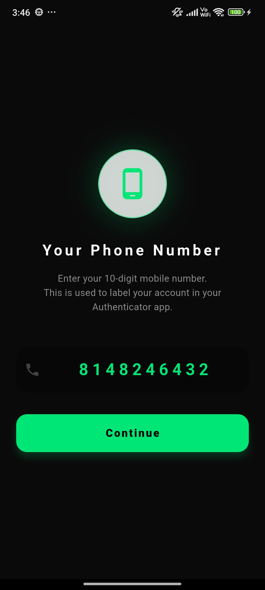
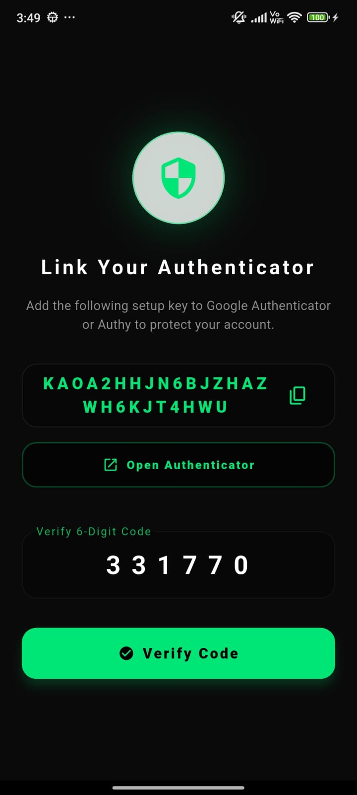
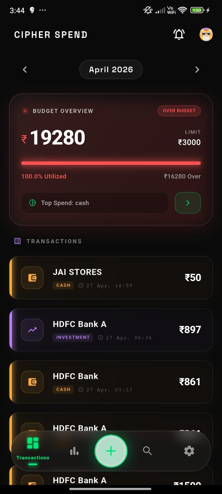
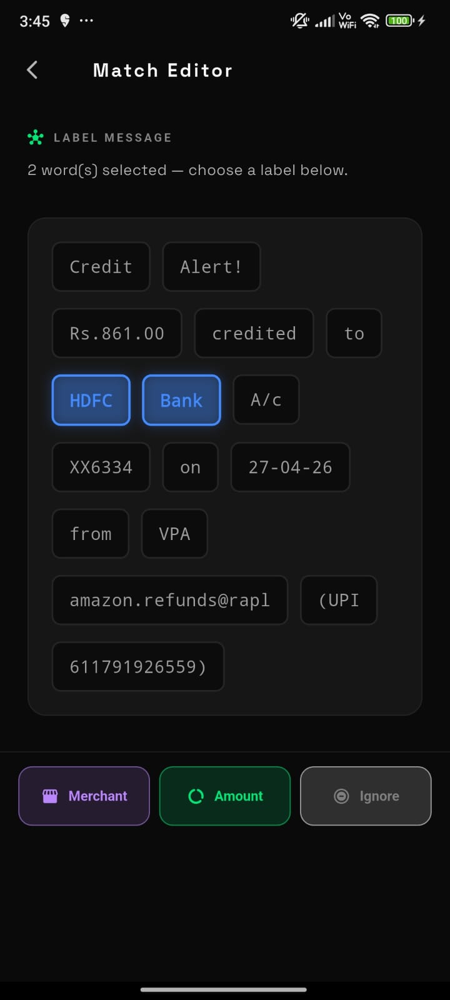

# 🛡️ CipherSpend


**CipherSpend** is a 100% offline, privacy-first personal finance tracker and intelligent transaction parser built natively for Android using **Jetpack Compose**. Operating entirely on-device with zero cloud dependencies, CipherSpend acts as an encrypted personal vault—combining native SMS extraction, on-device TensorFlow Lite classification, and military-grade SQLCipher encryption.

---

## 📱 App Previews

| Initial Setup & Security | Modern Dashboard | Smart Rule Editor |
|:---:|:---:|:---:|
| <br> |  |  |
| *Streamlined consumer onboarding & MPIN* | *Real-time spending velocity & budget alerts* | *Interactive token-based smart rule generator* |

---

## ✨ Key Features

### 🔒 100% Offline Privacy & Military-Grade Security
- **Zero Cloud Dependence** — No servers, no remote APIs, and zero telemetry. Financial data remains exclusively within the physical device hardware.
- **SQLCipher 256-bit AES Encryption** — All transactions, user configurations, and custom rules are sealed in an encrypted SQLite database using SQLCipher.
- **Master MPIN & Biometrics** — Seamless daily access via 4-digit Master MPIN, hardware-backed Fingerprint, or Face Unlock using AndroidX Biometrics.
- **Screen & Memory Protection** — Enforced `FLAG_SECURE` against screenshots, screen recording, and unauthorized task switch previews.
- **High-Risk Guard with Opt-In TOTP** — Advanced Vault Mode (TOTP RFC 6238) pairs directly with Google Authenticator, Aegis, 2FAS, or Authy via standard `otpauth://` URIs, guarding sensitive actions like permanent data erasure.

### ⚡ Streamlined Consumer Onboarding
- **Zero-Friction Startup** — Replaces complex multi-step security flows with a friendly 3-step setup:
  1. **Profile Setup** — Set user display name, monthly target budget, and monthly salary cycle day.
  2. **MPIN & Biometric Setup** — Configure a 4-digit Master MPIN with optional biometric quick-unlock.
  3. **Main Dashboard** — Ready to track expenses instantly.

### 🧠 On-Device NLP & Intelligent Transaction Parsing
- **Automated Bank SMS Parsing** — Real-time transaction capture via native Android `BroadcastReceiver` supporting major banks (HDFC, SBI, ICICI, Axis, Kotak, etc.) and UPI services (Google Pay, PhonePe, Paytm, BHIM, CRED).
- **On-Device TensorFlow Lite AI** — High-speed offline neural network inference (`cipherspend_model.tflite`) classifies transactions into 8 curated expense categories (*Food & Dining, Shopping, Bills & Utilities, Travel, Investment, Cash, etc.*) without latency or privacy trade-offs.
- **Smart Rule Editor (Interactive NER)** — Visual token-based extraction tool allowing users to tap and label words (*Merchant, Amount, Ignore*) in unparsed SMS messages to dynamically generate regex matching patterns.
- **Duplicate Detection & Deduplication** — Real-time cryptographic hashing prevents re-parsing duplicate SMS alerts.

### 📊 Real-Time Financial Intelligence
- **Spending Velocity & Cycle Tracking** — Dynamic calculation of monthly burn rate relative to elapsed salary cycle days.
- **Predictive Budget Alerts** — Proactive native notifications when expenses approach 80% and 100% of your configured monthly threshold.
- **Transaction Receipt View** — Detailed receipt screen featuring custom ticket clipping visuals, editable merchants, category reassignment, and raw SMS inspection with typewriter animation.

---

## 🛠 Tech Stack

| Component | Technology | Description |
|---|---|---|
| **Platform** | Android Native (API 26 to API 35) | Optimized for modern Android versions up to Android 15 |
| **Language** | Kotlin 2.0.21 | 100% native codebase with zero bridge overhead |
| **UI Framework** | Jetpack Compose + Material 3 | Modern declarative UI, glassmorphic styling, and fluid animations |
| **Architecture** | MVVM + Clean Architecture | Structured with ViewModel, StateFlow, Coroutines, and Repository patterns |
| **Local Database** | Room 2.6.1 + SQLCipher 4.5.4 | 256-bit AES encrypted local persistence |
| **Machine Learning** | TensorFlow Lite Support 0.4.4 | On-device NLP categorization model |
| **Authentication** | AndroidX Biometric + RFC 6238 TOTP | Biometric prompt with hardware Keystore + HMAC-SHA1 TOTP |
| **Background Processing** | Android Telephony + BroadcastReceiver | High-priority SMS capture and background inbox synchronization |

---

## 🏗 System Architecture

```text
               ┌────────────────────────────────────────────────────────┐
               │                Android System Events                   │
               │   • SMS_RECEIVED Broadcast      • SMS Inbox Sync       │
               └──────────────────────────┬─────────────────────────────┘
                                          │
                                          ▼
               ┌────────────────────────────────────────────────────────┐
               │                     Native Layer                       │
               │   • SmsBackgroundReceiver.kt                           │
               │   • NotificationService.kt                             │
               │   • SmsSyncManager.kt (Inbox Batch Parser)             │
               └──────────────────────────┬─────────────────────────────┘
                                          │
                        ┌─────────────────┴─────────────────┐
                        ▼                                   ▼
          ┌───────────────────────────┐       ┌───────────────────────────┐
          │  Regex Pattern Extraction │       │  On-Device TFLite Engine  │
          │  (SmsParser / CustomRule) │       │  (AiCategorizationService)│
          └─────────────┬─────────────┘       └─────────────┬─────────────┘
                        │                                   │
                        └─────────────────┬─────────────────┘
                                          ▼
               ┌────────────────────────────────────────────────────────┐
               │           Encrypted Data Layer (Room + SQLCipher)      │
               │   • TransactionDao       • CustomRuleDao               │
               │   • IgnoredHashDao       • DatabaseProvider (AES-256)  │
               └──────────────────────────┬─────────────────────────────┘
                                          │
                                          ▼ StateFlow / Coroutines
               ┌────────────────────────────────────────────────────────┐
               │                   Presentation Layer                   │
               │   • AuthViewModel        • TransactionViewModel        │
               │   • Jetpack Compose Screens (Material 3 + Theme)       │
               └────────────────────────────────────────────────────────┘
```

---

## 📁 Repository Structure

```text
CipherSpend-v1/
├── app/
│   ├── build.gradle.kts                   # App-level dependencies, SDK 35, ProGuard & signing config
│   ├── proguard-rules.pro                 # R8 optimization & SQLCipher/TFLite keep rules
│   └── src/main/
│       ├── AndroidManifest.xml            # Permissions, receivers, and services
│       ├── assets/
│       │   ├── cipherspend_model.tflite   # Quantized on-device categorization model
│       │   ├── labels.json                # Category taxonomy mapping
│       │   └── vocab.json                 # NLP tokenizer vocabulary
│       └── kotlin/com/example/cipherspend/
│           ├── CipherApplication.kt       # Application class (SQLCipher library loader)
│           ├── MainActivity.kt            # Compose Navigation Host & Biometric prompt
│           ├── NotificationService.kt     # Financial notification listener
│           ├── SmsBackgroundReceiver.kt   # Real-time SMS broadcast listener
│           ├── data/
│           │   ├── dao/                   # Room Data Access Objects
│           │   │   ├── CustomRuleDao.kt
│           │   │   ├── IgnoredHashDao.kt
│           │   │   └── TransactionDao.kt
│           │   ├── db/                    # Encrypted database provider
│           │   │   ├── AppDatabase.kt
│           │   │   └── DatabaseProvider.kt
│           │   └── model/                 # Room Entities
│           │       ├── CustomRuleEntity.kt
│           │       ├── IgnoredHashEntity.kt
│           │       └── TransactionEntity.kt
│           ├── service/                   # Domain Services
│           │   ├── AiCategorizationService.kt # TFLite inference runner
│           │   ├── SmsParser.kt           # Rule-based extraction & NER fallback
│           │   └── SmsSyncManager.kt      # Inbox sync engine
│           └── ui/
│               ├── components/            # Reusable UI components & dialogs
│               │   ├── HighRiskGuardDialog.kt
│               │   ├── MainAppScaffold.kt
│               │   └── ProminentDisclosureDialog.kt
│               ├── screens/               # Compose Screen Destinations
│               │   ├── DashboardScreen.kt
│               │   ├── InteractiveTrainingScreen.kt
│               │   ├── ManualEntryScreen.kt
│               │   ├── MpinSetupScreen.kt
│               │   ├── ProfileEditScreen.kt
│               │   ├── ProfileSetupScreen.kt
│               │   ├── SettingsScreen.kt
│               │   ├── StartupScreen.kt
│               │   ├── TransactionDetailScreen.kt
│               │   └── UnlockScreen.kt
│               ├── theme/                 # Cyber-slate theme tokens & styling
│               └── viewmodel/             # ViewModels & StateFlow providers
│                   ├── AuthViewModel.kt
│                   └── TransactionViewModel.kt
├── gradle/                                # Gradle wrapper configuration
├── screenshots/                           # UI previews and documentation media
└── build.gradle.kts                       # Root project build script
```

---

## 🚀 Getting Started

### Prerequisites
- **JDK 17** or higher
- **Android Studio** Ladybug (2024.2+) or higher
- **Android SDK Platform 35** (Android 15)
- Android physical device or emulator running **API 26+**

### Building from Source

1. **Clone the repository:**
   ```bash
   git clone https://github.com/SABARISH0014/cipherspend-compose.git
   cd cipherspend-compose
   ```

2. **Assemble the Debug APK:**
   ```bash
   ./gradlew assembleDebug
   ```

3. **Install on connected device:**
   ```bash
   adb install -r app/build/outputs/apk/debug/app-debug.apk
   ```

4. **Assemble the Production Release APK:**
   ```bash
   ./gradlew assembleRelease
   ```
   *(The production build applies full R8 minification, dead code elimination, and resource shrinking).*

---

## 🛡️ Play Store Compliance & Permission Disclosures

CipherSpend is designed to comply with Google Play's **Sensitive Permissions and Financial Data Policies**:

- **No `PACKAGE_USAGE_STATS`:** CipherSpend does not request or inspect system-wide app usage.
- **SMS Permission Justification:** `RECEIVE_SMS` and `READ_SMS` are utilized exclusively on-device for the primary app purpose of real-time expense extraction.
- **Prominent Disclosure:** Before requesting SMS permissions, a dedicated, user-facing disclosure dialog is presented outlining how SMS messages are parsed locally without being uploaded to any server.
- **100% Offline Integrity:** No network requests, no external tracking analytics, and no third-party cloud SDKs.

---

## 🤝 Contributing

We welcome contributions! To maintain the core privacy guarantee of CipherSpend:
1. **Never introduce external network calls or cloud analytics libraries.** All processing must execute 100% locally on the device.
2. Keep code modular, strictly typed, and formatted according to Kotlin and Jetpack Compose best practices.
3. Test builds using `./gradlew assembleRelease` before submitting a Pull Request.

---

## 📄 License

This project is licensed under the MIT License — see the LICENSE file for details.